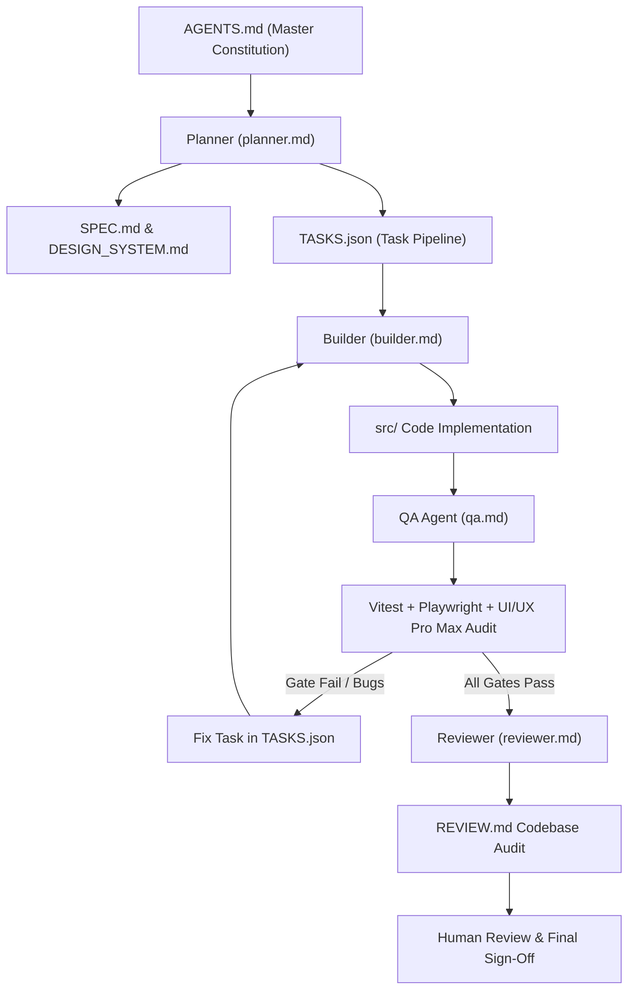
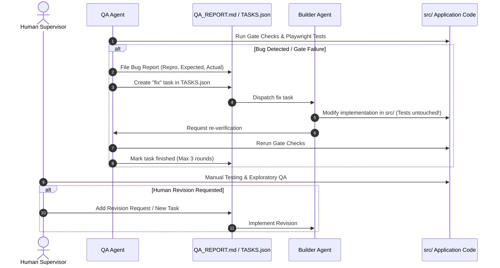

<div align="center">


# Aced

**Crowdsourced Deadline Board per Class**  
*A collaborative web app solving deadline tracking for students.*

<p align="center">
  <a href="https://react.dev/"></a>
  <a href="https://www.typescriptlang.org/"></a>
  <a href="https://vitejs.dev/"></a>
  <a href="https://tailwindcss.com/"></a>
  <a href="https://vitest.dev/"></a>
  <a href="https://playwright.dev/"></a>
  <a href="data/README.md"></a>
  <a href="DESIGN_SYSTEM.md"></a>
  <a href="AGENTS.md"></a>
</p>

<p align="center">
  <a href="#1-what-problem-this-app-solves">Problem</a> •
  <a href="#2-target-demography">Target Demography</a> •
  <a href="#3-core-features">Features</a> •
  <a href="#4-wireframes--visual-references">Wireframes</a> •
  <a href="#5-ai-prompt--multi-agent-orchestration">AI Prompts</a> •
  <a href="#6-testing-strategy--quality-assurance">Testing</a> •
  <a href="#7-problem-resolution--bug-fixing-architecture">Bug Fixing</a> •
  <a href="#8-quickstart--zero-config-demo">Quickstart</a>
</p>

</div>

---

## 1. What Problem This App Solves

Students frequently miss homework, project deadlines, and test preparation windows because teachers announce assignments in inconsistent, fragmented channels:
- **Missing Due Dates**: Teachers frequently post tasks on Google Classroom but omit an explicit due date, leaving assignments floating without an urgency anchor.
- **Unused LMS Tools**: Many teachers do not use Google Classroom or learning management systems at all, announcing tasks verbally in class or writing them on physical whiteboards.
- **Ephemeral Group Chats**: Other deadlines are announced in rapid-fire class group chats (WhatsApp, Telegram, Discord), where critical dates quickly get buried under chatter and lost.
- **No Single Source of Truth**: Because announcements are scattered across different platforms and formats, students lack a single, reliable board to see everything due for their class.

> [!NOTE]
> **The Aced Solution**: A shared, crowdsourced deadline board designed specifically per class. Any student in the class can add upcoming assignments, supply missing due dates, and update course notes. To safeguard collaborative editing against mistakes or vandalism, every change is tracked in an audit history log with editor attribution, and the designated Class Leader can revert any edit with a single tap.

---

## 2. Target Demography

- **Primary Demographic — Students**: High school and college/university students accessing the application predominantly from their mobile phones (minimum 375px viewport) on the go between classes. They need an ultra-low-friction tool without password fatigue, complex onboarding, or administrative delays.
- **Secondary Demographic — Class Leaders (Representatives)**: Class presidents, vice-presidents, or designated student representatives responsible for keeping class information accurate, auditing submitted dates, managing the subjects directory, and rolling back erroneous changes.
- **Context & Educational Setting**: Developed for a school application challenge focusing on practical tools that solve real school problems, built to be lightweight, dependable offline, and simple to demonstrate.

---

## 3. Core Features

### 3.1 Class Join & Student Session
- **Zero Friction**: Join instantly with a display name and class join code (`ACED2026`). No passwords, account registration, or OAuth permissions required.
- **Demo Autofill**: A dedicated "Fill Demo Code" button enables instant testing and demonstration.
- **Class Creation & Leadership Transfer**: Any student can create a new class, automatically receive Class Leader privileges, and transfer leadership to classmates when needed.

### 3.2 Crowdsourced Deadline Board
- **Dynamic Urgency Grouping**: Automatically categorizes assignments into six distinct status groups:
  1. *Needs a date* — Prominently surfaces assignments announced without a confirmed due date, prompting classmates to supply it.
  2. *Overdue* — Flags past-due assignments requiring immediate attention.
  3. *Due today* — Highlights critical tasks due before the end of the day.
  4. *This week* — Displays assignments due within the next 7 days.
  5. *Later* — Future upcoming assignments.
  6. *Done* — Completed tasks.
- **Metrics Strip**: Displays real-time counts for Overdue, Due Today, and Needs Date with dedicated icons and badges.
- **Subject Filtering**: Quick filter pills allow students to focus on individual subjects or view all assignments simultaneously.
- **Completion Checkbox**: Accessible toggle with a 44px+ touch target that instantly moves tasks between active groups and the *Done* bucket.

### 3.3 Collaborative Assignment Management
- **Add / Edit Modal**: Accessible dialog supporting assignment title (required), subject selection, date (`YYYY-MM-DD`), and notes.
- **Validation**: Client-side date and text validation preventing malformed entries.
- **Attribution**: Every creation and edit records the editor's display name and timestamp.

### 3.4 Class Subjects Directory
- Centralized course cards listing subjects and teacher names.
- Tracks active assignments and flags how many assignments in that subject are missing due dates.
- Modal dialogs for adding and editing subjects with complete change history tracking.

### 3.5 Safeguarded Crowdsourcing: Audit History & Rollback
- **Comprehensive Audit Trail**: Chronological activity feed recording the modified entity (assignment or subject), field changed, previous value, new value, editor identity, and timestamp.
- **Class Leader Revert Privilege**: To keep the board clean while maintaining open collaboration, only the designated Class Leader can perform one-tap reverts and state rollbacks.
- **Confirmation Diff**: Revert dialog displays side-by-side "Current" vs. "Restore to" comparisons before confirming changes.

### 3.6 Architecture Seams & Classroom Import
- **Offline-First Storage Seam**: UI interacts solely with an abstract `AcedRepository` interface. Persists locally via `LocalRepository` (`localStorage` under `aced.db.v1` with bundled seed data) and seamlessly switches to `SupabaseRepository` when Postgres/Auth environment variables are supplied.
- **Classroom Import Seam**: Designed behind `VITE_FEATURE_CLASSROOM_IMPORT` (default OFF) with an offline no-op provider. When disabled, the import UI is completely excluded from the DOM, ensuring no external API dependencies ever block core functionality.
- **Deterministic Date Utilities**: Plain `'YYYY-MM-DD'` string formatting and an injectable `getToday()` helper eliminate timezone drift and test unpredictability.

---

## 4. Wireframes & Visual References

The user interface of Aced was crafted using a hybrid approach combining code-based interactive wireframes with real-world visual design references:

### 4.1 Interactive HTML Wireframe (`wireframes.html`)
The structural wireframe is located in [`wireframes.html`](wireframes.html) in the repository root. It provides a self-contained, low-fidelity 1100×640 desktop canvas and responsive frames specifying the layout for:
1. **Join Class**: Dual-pane layout with illustration/preview area and form inputs.
2. **Deadline Board**: Top search, action button, metrics tiles, subject chips, and urgency section cards.
3. **Subjects Directory**: Responsive grid of subject cards with teacher tags and action buttons.
4. **Audit History Feed**: Chronological change rows, diff tags, and revert triggers.
5. **Add/Edit Assignment Modal**: Floating dialog with form fields and attribution disclaimer.
6. **Revert Confirmation Dialog**: Side-by-side before/after value diff modal.

> **Partly Human-Authored**: The wireframe layout was partially designed and curated by the human developer to establish the exact UX hierarchy, spacing proportions, and component flow for the agents to follow.

### 4.2 Visual Reference Screenshots (`references/`)
The [`references/`](references/) directory contains real-world visual references used to guide the aesthetic, typography, and styling:
- [`references/landing-page-section1.png`](references/landing-page-section1.png): Editorial hero section, typography pairings, and layout contrast.
- [`references/landing-page-section2.png`](references/landing-page-section2.png): Bento-style feature showcase grids and pill-style indicators.
- [`references/landing-page-section3.png`](references/landing-page-section3.png): Deep contrast value proposition section and roadmap layout.
- [`references/login.png`](references/login.png): Minimalist dual-pane split authentication layout with high-contrast form card.

### 4.3 Why HTML Wireframes vs. PNG References?

| Format | File | Rationale |
| :--- | :--- | :--- |
| **HTML Wireframe** | [`wireframes.html`](wireframes.html) | **1. Token Efficiency**: A declarative HTML/CSS document consumes a fraction of the token budget compared to encoding multiple high-resolution image files into LLM context windows.<br>**2. Universal Model Compatibility**: Ensures text-only models and environments without multimodal vision capabilities can parse, understand, and build the UI accurately.<br>**3. Explicit Semantic Hierarchy**: Exposes actual DOM elements, button classes, nesting relationships, and text labels directly, eliminating visual ambiguity. |
| **PNG References** | [`references/*.png`](references/) | **1. Taken from Live Production Websites**: Reference screenshots were captured from live, production web applications (e.g. Linear, Notion, modern SaaS tools).<br>**2. Preserves Layout Fidelity Without Asset Breakdown**: Saving modern production web pages as raw HTML frequently breaks due to cross-origin CDN stylesheets, client-side rendering bundles, third-party scripts, and missing web assets. PNG screenshots faithfully capture the typography, color tones, micro-spacing, and mood without dependency fragility. |

---

## 5. AI Prompt & Multi-Agent Orchestration

### 5.1 The Master Prompt: `AGENTS.md`
The master prompt governing autonomous agent behavior is defined in [`AGENTS.md`](AGENTS.md). It serves as the project's constitution, establishing:
- Operating modes, strict environment safety rules (e.g., never touch `.env`, no external network calls during tests).
- Architectural boundaries (storage seam, deterministic dates, no direct Supabase imports in UI).
- Mandatory gate checks (`tsc`, `npm test`, `npm run build`, `playwright test`) required for every task.
- The sequential execution pipeline connecting specialized agent roles.

### 5.2 Multi-Agent Role Architecture
The agent system operates through four distinct roles defined in [`agent/roles/`](agent/roles/):



1. **Planner ([`agent/roles/planner.md`](agent/roles/planner.md))**:
   - Runs once at project inception.
   - Reads `AGENTS.md`, creates the `dev` git branch, authors [`SPEC.md`](SPEC.md) and [`DESIGN_SYSTEM.md`](DESIGN_SYSTEM.md), and breaks the project down into granular, testable tasks in [`TASKS.json`](TASKS.json).
   - *Strict boundary*: Writes zero application code.
2. **Builder ([`agent/roles/builder.md`](agent/roles/builder.md))**:
   - Implements one task at a time from [`TASKS.json`](TASKS.json).
   - Writes application code in `src/`, config files, and scaffolding.
   - Makes atomic git commits per feature (`<feature id>: <title>`).
   - *Strict boundary*: Never modifies test files in `tests/` or `e2e/`.
3. **QA ([`agent/roles/qa.md`](agent/roles/qa.md))**:
   - Independently verifies the Builder's output without trusting internal reasoning.
   - Writes unit/component tests in `tests/` and browser E2E specs in `e2e/`.
   - Audits interfaces against design system tokens and mobile usability standards.
   - Files structured defect reports and assigns `fix` tasks when checks fail.
   - *Strict boundary*: Never edits application code in `src/`.
4. **Reviewer ([`agent/roles/reviewer.md`](agent/roles/reviewer.md))**:
   - Executes after all implementation tasks are finished.
   - Conducts a comprehensive codebase audit checking for architectural leaks, dead code, bundles, and specification compliance, recording findings in [`REVIEW.md`](REVIEW.md).

### 5.3 State Management & Coordination Files
- [`TASKS.json`](TASKS.json): Machine-readable Kanban state tracking feature-level criteria (`todo`, `ongoing`, `finished`).
- [`.run/progress.log`](.run/progress.log): Append-only chronological execution log.
- [`.run/blocked.txt`](.run/blocked.txt): Escalation circuit breaker signaling when human intervention is needed.

---

## 6. Testing Strategy & Quality Assurance

Aced utilizes a multi-layered testing and verification strategy to guarantee production quality:

### 6.1 Dedicated QA Agent & `ui-ux-pro-max` Guidelines
A specialized QA agent inspects the running application against the `ui-ux-pro-max` design intelligence skill and accessibility rules:
- **Touch Target Verification**: Every interactive button, input, tab, and completion checkbox must meet or exceed the **44×44px** minimum tap target rule for mobile accessibility.
- **Non-Color State Discrimination**: Verifies that task status (overdue, due today, needs date, completed) is never conveyed by color alone, but is always reinforced with explicit icons and text labels.
- **Semantic HTML & ARIA**: Checks for proper `<main>`, `<nav>`, `<dialog>`, `aria-label`, and `aria-busy` skeleton states.
- **Responsive Layout**: Validates clean viewport adaptation across mobile (375px) and desktop (1280px) resolutions.

### 6.2 Multi-Layered Automated Test Suite
- **Unit & Component Tests (`tests/`)**: 42 unit and component tests powered by Vitest and React Testing Library covering date manipulation, storage drivers, fallback seams, input validation, and component state transitions. Tests run in strict offline mode (`fetch` is blocked in test setup).
- **End-to-End User Journey Tests (`e2e/`)**: 10 Playwright test suites executing realistic browser interactions:
  - Class creation, onboarding, and leadership assignment.
  - Adding assignments and verifying dynamic urgency bucketing.
  - Filtering by subject and toggling task completion.
  - Adding, editing, and deleting subjects.
  - Verifying student view-only permissions on history vs. Class Leader revert privileges.
  - Verifying the Classroom Import UI is completely omitted from the DOM when disabled.
  - Cross-device execution across 375px mobile and 1280px desktop viewports.

### 6.3 Automated 4-Command Gate Checks
Before any task can be marked `finished`, the QA agent enforces that all four gate commands pass with exit code 0:
1. `npx tsc --noEmit` (TypeScript strict mode verification)
2. `npm test` (Vitest unit and component tests)
3. `npm run build` (Vite production bundle build)
4. `npx playwright test` (Playwright end-to-end browser tests)

### 6.4 Human-in-the-Loop Final Sign-off
Automated testing is supplemented by human verification. At the end of development sessions and major milestones, the human developer runs the application locally (`npm run dev`), interacts with the UI in a real browser, validates micro-interactions and tactile feel, and records final sign-off in [`docs/07-ai-usage-log.md`](docs/07-ai-usage-log.md).

---

## 7. Problem Resolution & Bug-Fixing Architecture

The project features a structured, closed-loop architecture for detecting, isolating, and fixing defects:



1. **Defect Detection**: The QA agent identifies broken features, layout regressions, or failing tests during gate execution.
2. **Defect Logging**: QA logs a formal bug entry in `QA_REPORT.md` (or `REVIEW.md`), documenting:
   - Unique bug identifier (e.g. `B1`, `B2`).
   - Step-by-step reproduction instructions.
   - Expected vs. actual behavior and severity rating.
   - Any requested `data-testid` hooks required for testing.
3. **Targeted Remediation**: The QA agent appends a `fix` task to `TASKS.json` linked to the bug report. The Builder agent reads the issue, fixes the source code in `src/`, and commits the patch. **The Builder is strictly prohibited from modifying test files to make tests pass.**
4. **Escalation Circuit Breaker**: If a bug cannot be resolved within 3 fix cycles, the agent halts, writes `.run/blocked.txt`, and alerts the human supervisor to prevent infinite loops.
5. **Human Review & Revisions**: The human developer performs manual smoke tests at the end of sessions. Any identified visual flaws, ergonomics issues, or scope changes are submitted back into the pipeline as revision tasks (as demonstrated in tasks T12–T15 in `.run/progress.log`).

---

## 8. Quickstart & Zero-Config Demo

Aced is designed to run completely offline out of the box with zero configuration:

```bash
# 1. Install dependencies
npm install

# 2. Start local development server
npm run dev
```

Open [http://localhost:5173](http://localhost:5173) in your browser:
- On the join screen, enter your name and class code **`ACED2026`** (or click **"Fill Demo Code"**).
- You will immediately enter the bundled demo class (**"Class of 2026 — Period 3"**) with 6 subjects, pre-loaded assignments across all urgency groups, and demonstrable edit history.

---

## 9. Technology Stack & Architecture

- **Frontend**: React 19, TypeScript (strict mode), Vite, Tailwind CSS, Lucide icons, React Router (HashRouter).
- **Design System**: shadcn/ui (`new-york` style, neutral base, indigo primary, 0.5rem radius, Inter typography), mobile-first 375px responsive layout, 44px+ tap targets.
- **Storage Seam**: UI depends exclusively on the async `AcedRepository` interface:
  - `LocalRepository`: Local storage persistence under key `aced.db.v1` with bundled seed data (default).
  - `SupabaseRepository`: Optional Postgres/RLS backend when configured.
  - See [`data/README.md`](data/README.md) for database schema and setup.
- **Deterministic Dates**: All dates use strictly plain `'YYYY-MM-DD'` strings and an injectable `getToday()` helper.
- **Classroom Import**: Built behind `VITE_FEATURE_CLASSROOM_IMPORT` (default OFF) with an offline no-op provider. When disabled, the UI is completely omitted from the DOM.

---

## 10. Gate Commands & Build Verification

Aced is covered by an automated test suite with 100% pass rates:

```bash
# Run unit & component tests (Vitest + React Testing Library)
npm test

# Run end-to-end browser tests (Playwright with system Chromium)
npx playwright test

# Check TypeScript types
npx tsc --noEmit

# Production build
npm run build
```

---

## 11. Project Documentation

Detailed project documentation is available in the [`docs/`](docs/) directory:
- [`docs/01-problem-and-users.md`](docs/01-problem-and-users.md): Problem breakdown and student personas.
- [`docs/02-features.md`](docs/02-features.md): Detailed feature specifications.
- [`docs/04-wireframes.md`](docs/04-wireframes.md): Mobile ASCII wireframes and layout structures.
- [`docs/05-test-results.md`](docs/05-test-results.md): Real test suite output and coverage metrics.
- [`docs/06-bugs-and-fixes.md`](docs/06-bugs-and-fixes.md): Log of real bugs encountered and resolved.
- [`docs/07-ai-usage-log.md`](docs/07-ai-usage-log.md): AI usage disclosure and pipeline logs.
- [`data/README.md`](data/README.md): Database schema and optional Supabase instructions.
